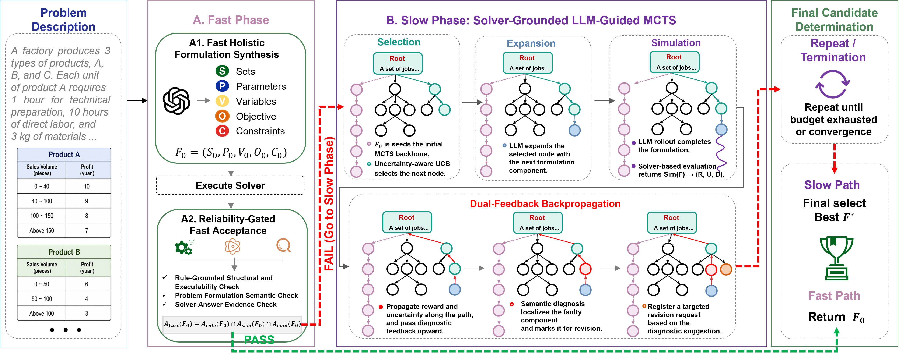

<div align="center">

# 🧠 DG-MCTS

### Deliberation-Gated Monte Carlo Tree Search

**A Hybrid Reasoning Algorithm for Automated Optimization Modeling**

*Think fast. Deliberate when needed.*


<br><br>

[🧩 Overview](#-overview) · [📊 Results](#-results) · [🚀 Quick Start](#-quick-start) · [📓 Notebook](reproduce_results.ipynb) · [🗂️ Data](#-code--data)

</div>

<br>

<p align="center">
  <a href="assets/main_figure.png"></a>
</p>

<p align="center"><sub>From a natural-language decision problem to an executable optimization model. Click the overview to enlarge.</sub></p>

## 🧩 Overview

**DG-MCTS combines fast formulation synthesis with selective, diagnosis-guided search.** An LLM proposes the model; execution checks and semantic review decide whether to accept it or refine it through Monte Carlo tree search.

<table>
<tr>
<td align="center" width="33%">
<h2>⚡</h2>
<h3>Generate</h3>
<p>Synthesize sets, parameters, variables, objective, and constraints together.</p>
</td>
<td align="center" width="33%">
<h2>🛡️</h2>
<h3>Evaluate &amp; Gate</h3>
<p>Combine solver feedback, automatic checks, and semantic review.</p>
</td>
<td align="center" width="33%">
<h2>🌳</h2>
<h3>Search &amp; Revise</h3>
<p>Reuse the initial model and guide component revisions with diagnoses.</p>
</td>
</tr>
</table>

> [!TIP]
> **Selective deliberation:** accept reliable initial candidates directly; reuse their formulation and feedback when deeper search is needed.

## 📊 Results

### Core benchmarks

Solving accuracy (%). **Bold** marks the best DG-MCTS backbone result in each column.

| Backbone | NL4Opt | NLP4LP | Mamo-E | ComplexOR | Mamo-C | IndustryOR |
|:--|--:|--:|--:|--:|--:|--:|
| GPT-4o-mini | 81.4 | 79.8 | 87.0 | 66.7 | 40.8 | 40.0 |
| o4-mini | 88.3 | 85.5 | 86.3 | **88.9** | 66.8 | 60.0 |
| Gemini-2.5-Flash | **89.6** | 86.0 | 86.2 | 77.8 | 68.7 | **62.0** |
| GPT-5.4-mini | 87.9 | **86.8** | **88.3** | 83.3 | **73.9** | **62.0** |

[Full method comparison →](results/table2_core_accuracy.csv)

### Extended benchmarks

GPT-5.4-mini backbone. Gains are percentage points over Fast Only.

| Benchmark | Instances | Fast Only | DG-MCTS | Gain |
|:--|--:|--:|--:|--:|
| Large-Scale-OR | 101 | 93.1% | **94.1%** | +1.0 |
| Air-NRM (CA) | 15 | 86.7% | **100.0%** | +13.3 |
| Air-NRM (NP-Flow) | 21 | 85.7% | **95.2%** | +9.5 |
| OptiBench | 605 | 73.2% | **76.7%** | +3.5 |
| OptMATH-Bench | 166 | 36.7% | **42.2%** | +5.5 |

[Counts and published comparisons →](results/table3_extended_accuracy.csv)

### Accuracy and inference cost

Route comparison on 250 instances; costs are means per instance.

| Route | Solving accuracy | LLM calls | Tokens | Time (s) |
|:--|--:|--:|--:|--:|
| Fast Only | 70.8% | 3.2 | 13,192 | 19.3 |
| **DG-MCTS** | **76.0%** | **62.9** | **259,324** | **305.3** |
| Always Slow | 75.6% | 96.8 | 374,658 | 403.4 |

> [!NOTE]
> **Comparable accuracy with less computation:** DG-MCTS uses about **35% fewer calls**, **31% fewer tokens**, and **24% less time** than Always Slow in this comparison.

[Route results →](results/table4_routes.csv) · [Acceptance and routing →](results/table5_routing.csv) · [Formulation reuse →](results/table6_search_outcomes.csv) · [Diagnostic recovery →](results/table6_diagnosis.csv) · [Reward sensitivity →](results/reward_sensitivity.csv)

## 🚀 Quick Start

### 📓 Explore the results

Run the notebook to aggregate the released observations and regenerate the result CSV files. No API or solver is needed.

```bash
python -m pip install pandas jupyterlab ipykernel
jupyter lab reproduce_results.ipynb
```

Or use Python alone: `python code/reproduce.py`.

### 🤖 Run DG-MCTS

```bash
python -m pip install -r requirements.txt
cp config.example.yaml config.yaml
python src/main.py --config config.yaml --dataset nl4opt --limit 1
```

Set `OPENAI_API_KEY` in your environment and configure the provider URL and model in `config.yaml`. Execution uses an OpenAI-compatible API, Pyomo, and Gurobi with a valid license. The example runs one instance with a 20-iteration search budget.

## 🗂️ Code & Data

| Start here | What's inside |
|:--|:--|
| [📓 Reproduction notebook](reproduce_results.ipynb) | Read the observations, compute statistics, and explore results |
| [🤖 Core implementation](src/) | Generation, reliability gating, MCTS, evaluation, and prompt templates |
| [🧮 Statistics code](code/) | Aggregation, numerical comparisons, and diagnostic mapping |
| [🗃️ Benchmark inputs](data/datasets/) | **2,362 instances** across six core and five extended benchmarks |
| [🔬 Experiment data](data/) | Per-instance outcomes, routing, costs, targets, and reward configurations |
| [📊 Results](results/) | Accuracy, efficiency, routing, recovery, and sensitivity summaries |

<details>
<summary><b>🔎 Implementation map</b></summary>

| Module | Role |
|:--|:--|
| `src/main.py` | End-to-end execution and configuration |
| `src/solver/mcts/search.py` | Tree initialization, search, revision, and backpropagation |
| `src/solver/mcts/node.py` | Node statistics and selection score |
| `src/solver/mcts/llm_generator.py` | Component generation and diagnosis-guided revision |
| `src/solver/evaluation.py` | Execution checks, semantic review, rewards, and acceptance |
| `src/assets/` | Synthesis, review, and search prompts |

</details>

<br>

<div align="center">

**Natural language → Optimization formulation → Executable solution**

Code: [MIT License](LICENSE). Benchmark content retains its original attribution and usage terms.

</div>
